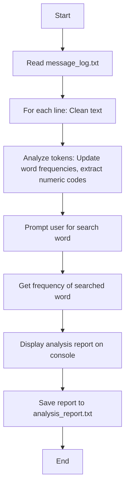

# Forensics Tool

A simple C++ tool for analyzing intelligence reports from text logs.

## Description

This tool reads text from `message_log.txt`, performs text cleaning and analysis including:
- Word frequency analysis
- Numeric code extraction
- Stop word filtering
- Search functionality for specific words

## Description

This tool reads text from `message_log.txt`, performs text cleaning and analysis including:
- Word frequency analysis
- Numeric code extraction
- Stop word filtering
- Search functionality for specific words

The analysis results are displayed on the console and saved to `analysis_report.txt`.

## Flowchart



## Requirements

- C++ compiler (e.g., g++, clang++)
- Standard C++ libraries

## Building

Compile the source code using a C++ compiler:

```bash
g++ forensics_tool.cpp -o forensics_tool
```

## Usage

1. Ensure `message_log.txt` exists in the same directory with the text to analyze.
2. Run the executable:
   ```bash
   ./forensics_tool
   ```
3. Enter a word to search for its frequency when prompted.
4. View the analysis report on the console and in `analysis_report.txt`.

## Files

- `forensics_tool.cpp`: Source code
- `message_log.txt`: Input file (text to analyze)
- `analysis_report.txt`: Output file (generated analysis report)