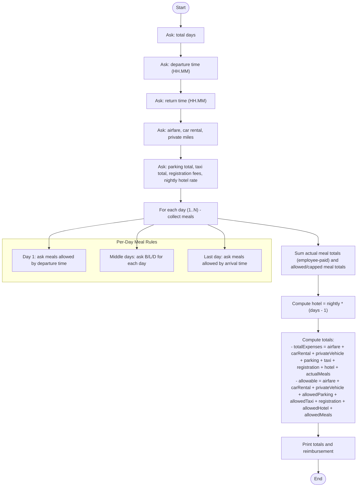

teamproject - Business Trip Expense Calculator

A small C++ console program (chapter 6 exercise) that collects travel expenses for a business trip and calculates:
- Total expenses (what the employee paid)
- Total allowable expenses (company-allowed amounts)
- Amount to be reimbursed (if expenses exceed allowed)

1. Follow prompts in order. Example input sequence (one per prompt):
   - Number of days: 5
   - Departure time (HH.MM): 05.30
   - Return time (HH.MM): 06.45
   - Airfare: 590
   - Car rental: 350
   - Miles driven with private vehicle: 0
   - Parking total: 34
   - Taxi total: 27
   - Registration fees: 125
   - Nightly hotel rate: 55
   - Meals for each day (the program asks only for allowed meals per first/last/middle days)

Outputs
- Total expenses
- Allowable expenses
- Amount to be reimbursed (or $0.00)

Flowchart

Notes
- Meal caps: breakfast $9, lunch $12, dinner $16
- Parking allowed up to $6/day; taxi allowed up to $10/day; hotel allowed up to $90/night
- Input validation rejects negative values and invalid times

If you'd like, I can:
- Add a non-interactive mode (read inputs from a file)
- Add an example test script that pipes inputs to the executable
- Add a short section describing how each allowance is computed
