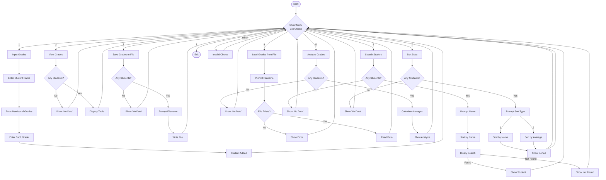

# Student Grades Management System

This is a simple C++ console program to manage student grades. You can add students, enter their grades, view, save, load, analyze, search, and sort student data.

## How to Compile

Open a terminal in this folder and run:

```sh
g++ -std=c++17 -O2 -Wall student_grades.cpp -o student_grades.exe
```

## How to Run

```sh
./student_grades.exe
```
Or on Windows:
```sh
student_grades.exe
```

## Features
- Add students and their grades
- View all students and grades
- Save/load data to/from a file
- Analyze grades (find highest/lowest average)
- Search for a student by name
- Sort students by name or average

## Data Files
Saved files are stored in the `data/` folder. Example: `data/grades.txt`

## Program Flowchart


